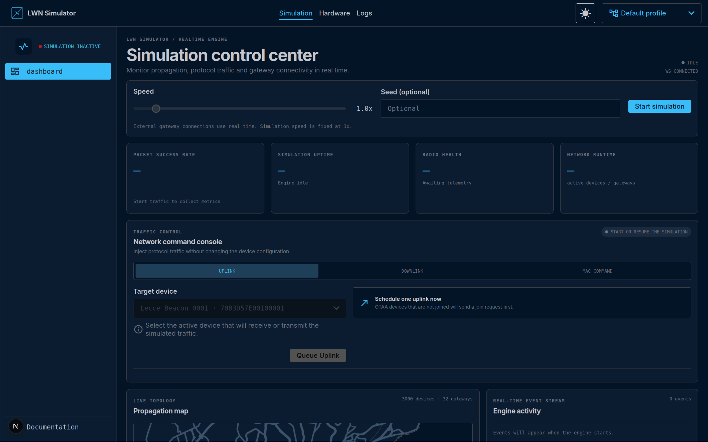

#  LWN Simulator

[](https://github.com/Giuseppe-Compagnone/LWN-Simulator/actions/workflows/ci.yml)
[](https://github.com/Giuseppe-Compagnone/LWN-Simulator/actions/workflows/deploy-docs.yml)
[](https://github.com/Giuseppe-Compagnone/LWN-Simulator/releases)
[](./LICENSE.txt)
[](https://go.dev/)
[](https://www.typescriptlang.org/)
[](https://go.dev/dl/)
[](https://nodejs.org/)
[](https://yarnpkg.com/)

LWN Simulator is a LoRaWAN network simulator for building, running and
inspecting realistic device and gateway scenarios. It can be used as a
standalone desktop application or as a web application connected to a local or
remote backend.

The simulator supports virtual networks, real gateway transports, ChirpStack
integration, repeatable simulations, profile-based configurations, persistent
logs and live updates through WebSocket connections.



## Documentation

The user documentation explains installation, configuration, hardware setup,
simulation controls, profiles, logs and ChirpStack integration:

<https://giuseppe-compagnone.github.io/LWN-Simulator/docs>

The documentation is available in English, Italian, Spanish, French and
German. Start with the [Getting Started guide](https://giuseppe-compagnone.github.io/LWN-Simulator/docs/en/getting-started/installation).

## Repository structure

The repository is a Yarn workspace containing the application layers and the
shared packages used by them.

### Applications

- [Backend](./apps/backend/README.md): Go API, simulation orchestration,
  persistence and real-time communication.
- [Frontend](./apps/frontend/README.md): Next.js web interface for managing
  networks and simulations.
- [Desktop](./apps/desktop/README.md): Electron shell that packages the
  frontend and can manage a local backend.
- [Launcher](./apps/launcher/README.md): connection screen used by the
  desktop application to select a local or remote backend.

### Shared packages

- [Contracts](./packages/contracts/README.md): OpenAPI schemas and generated
  TypeScript/Go models shared across the stack.
- [Engine](./packages/engine/README.md): deterministic Go simulation engine
  implementing the network, protocol and radio behavior.
- [SDK](./packages/sdk/README.md): TypeScript API client and React providers
  used by the frontend and launcher.
- [UI components](./packages/ui-components/README.md): reusable controls,
  layouts and Storybook scenarios.

## Requirements

- Node.js 24;
- Corepack with Yarn 4 enabled;
- Go 1.26 or newer for the backend and engine;
- Docker is optional and useful when running ChirpStack locally.

## Run from source

```bash
corepack enable
yarn install
yarn generate
yarn dev
```

The development command starts the frontend and backend together. The web
interface is normally available at <http://localhost:3000> and the backend at
<http://localhost:8080>.

To launch the Electron application with its local backend:

```bash
yarn dev:electron
```

## Useful checks

```bash
yarn generate       # regenerate shared API models
yarn typecheck      # type-check applications and packages
yarn lint           # run TypeScript, CSS and documentation linting
yarn test           # run backend and engine tests
yarn check          # run the complete validation pipeline
yarn build          # build distribution artifacts
```

## GitHub Actions

CI checks run when a pull request is opened, reopened or updated. GitHub Pages
publishes the documentation and Storybook on pushes to `main` or when the
deploy workflow is run manually.

To publish a distribution, set the same new version in
`package.json` and `apps/desktop/package.json`. Once the release workflow is
available on the default branch, open it in **Actions** under
**Publish desktop and server release**, select **Run workflow**, and choose the
branch or tag to build. The workflow publishes all Linux, macOS and Windows
downloads in one GitHub Release named `v<version>`. It publishes only after all
platform builds pass and includes a `SHA256SUMS` file for the downloads.

## License

LWN Simulator is distributed under the MIT license. See [LICENSE.txt](./LICENSE.txt).
